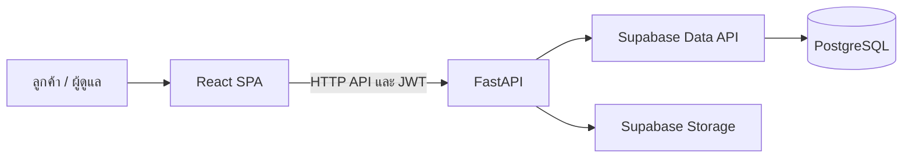

# E-Book Mart

ระบบร้านค้า e-book สำหรับลูกค้าและผู้ดูแล ประกอบด้วยเว็บ frontend, REST API และฐานข้อมูล PostgreSQL บน Supabase

## ความสามารถหลัก

- สมัครสมาชิก เข้าสู่ระบบ และจัดการบัญชีผู้ใช้
- ค้นหาและเรียกดู e-book ตามหมวดหมู่และผู้แต่ง
- จัดการตะกร้าสินค้า รายการโปรด และรีวิว
- สร้างคำสั่งซื้อ ส่งข้อมูลการชำระเงิน และติดตามสถานะคำสั่งซื้อ
- ดาวน์โหลด e-book หลังคำสั่งซื้อได้รับการยืนยัน
- หน้าผู้ดูแลสำหรับจัดการหนังสือ ผู้แต่ง หมวดหมู่ ผู้ใช้ คำสั่งซื้อ และรายงาน

## เทคโนโลยี

| ส่วน | เทคโนโลยี |
|---|---|
| Frontend | React 19, Vite, React Router, Axios, Tailwind CSS |
| Backend | Python, FastAPI, Uvicorn, Pydantic |
| Authentication | JWT และ bcrypt |
| Database และ Storage | Supabase, PostgreSQL, Supabase Storage |

## สถาปัตยกรรม



Frontend เรียก API ผ่าน `VITE_API_URL`; backend ติดต่อ Supabase ด้วยค่าจาก environment variables ส่วนการตรวจสิทธิ์และการทำงานกับข้อมูลอยู่ใน backend routers

## โครงสร้างโฟลเดอร์

```text
Web/
  backend/       FastAPI app, routers, models และ utilities
  frontend/      React app, pages, components, contexts และ API client
Supabase/
  ebookmart_live_schema.sql   PostgreSQL schema
  ebookmart_live_data.sql     ข้อมูลสำหรับฐานข้อมูล
  migrations/                 SQL migrations
  data-dictionary.md          รายละเอียดตารางและคอลัมน์
Mermaid/
  E-book-mart.mmd             ER diagram
```

## เริ่มต้นใช้งาน

### สิ่งที่ต้องมี

- Python และ pip
- Node.js และ npm
- โปรเจกต์ Supabase ที่ตั้งค่า URL และ API keys แล้ว

### 1. ตั้งค่า Supabase

เตรียมฐานข้อมูล Supabase และใช้ schema จาก `Supabase/ebookmart_live_schema.sql` เฉพาะเมื่อยืนยันแล้วว่าเป็นฐานข้อมูลเป้าหมายที่ถูกต้อง หากจะใช้ไฟล์ข้อมูลหรือ migration เพิ่มเติม ให้ตรวจเนื้อหาและสำรองข้อมูลก่อนนำไปรัน

### 2. ตั้งค่าและรัน backend

จาก PowerShell ที่โฟลเดอร์รากของ repository:

```powershell
cd Web/backend
py -m venv .venv
.\.venv\Scripts\Activate.ps1
python -m pip install -r requirements.txt
Copy-Item .env.example .env
```

แก้ `Web/backend/.env` และกำหนดค่าจริง:

| ตัวแปร | ใช้ทำอะไร |
|---|---|
| `SUPABASE_URL` | URL ของ Supabase project |
| `SUPABASE_KEY` | Supabase anon/publishable key |
| `SUPABASE_SERVICE_KEY` | Service key สำหรับงานที่ต้องใช้สิทธิ์ backend เช่น Storage; เก็บเป็นความลับ |
| `SECRET_KEY` | Signing key สำหรับ JWT; ใช้ค่าที่สุ่มและมีความยาวอย่างน้อย 32 ตัวอักษร |
| `DEBUG` | เปิดหรือปิดโหมด debug; ค่าเริ่มต้นในตัวอย่างคือ `false` |
| `CORS_ORIGINS` | รายการ origin ของ frontend คั่นด้วย comma; สำหรับ local ใช้ `http://localhost:5173` |

รัน API:

```powershell
uvicorn main:app --reload
```

API ทำงานที่ `http://localhost:8000`; เอกสาร OpenAPI อยู่ที่ `http://localhost:8000/docs` และ health check อยู่ที่ `http://localhost:8000/health`

### 3. ตั้งค่าและรัน frontend

เปิด terminal อีกหน้าต่างจากโฟลเดอร์ราก:

```powershell
cd Web/frontend
npm install
Copy-Item .env.example .env
```

กำหนด `VITE_API_URL` ใน `Web/frontend/.env` ให้ชี้ไปยัง backend เช่น:

```dotenv
VITE_API_URL=http://localhost:8000
```

จากนั้นรันเว็บ:

```powershell
npm run dev
```

Vite จะแสดง URL สำหรับเปิดเว็บ โดยปกติคือ `http://localhost:5173`

## คำสั่งตรวจสอบ

รันจาก `Web/frontend`:

```powershell
npm run lint
npm run build
```

การทดสอบ backend ที่มีอยู่เป็นสคริปต์แยกใน `Web/backend`; ติดตั้ง dependencies ก่อน แล้วเรียกสคริปต์ที่ต้องการ เช่น:

```powershell
python test_auth_simple.py
```

การทดสอบที่เชื่อมต่อ Supabase ต้องมี environment และฐานข้อมูลที่พร้อมใช้งาน

## โครงสร้างข้อมูล

ตารางหลักใน PostgreSQL schema `public` ได้แก่ `users`, `roles`, `ebooks`, `authors`, `categories`, `carts`, `cart_items`, `orders`, `order_items`, `payments`, `download_links`, `reviews` และ `wishlists` ดูรายละเอียดความสัมพันธ์และคอลัมน์ได้ที่ [Supabase/data-dictionary.md](Supabase/data-dictionary.md) และ [Mermaid/E-book-mart.mmd](Mermaid/E-book-mart.mmd)

## ความปลอดภัยและข้อควรทราบ

- ห้าม commit ไฟล์ `.env`, passwords, API keys หรือ JWT signing key
- ห้ามนำ `SUPABASE_SERVICE_KEY` ไปใส่ใน frontend; ใช้เฉพาะฝั่ง backend
- จำกัด `CORS_ORIGINS` ให้ตรงกับ frontend origin ที่อนุญาต
- ตรวจสอบและสำรองฐานข้อมูลก่อนนำ schema, data dump หรือ migration ไปรัน
- ระบบบันทึกข้อมูลการชำระเงินและสลิป แต่ repository ไม่ได้ระบุการเชื่อมต่อ payment gateway ภายนอก
- รายละเอียด flow และบันทึกสถานะการทดสอบเพิ่มเติมอยู่ใน [README.md](README.md)